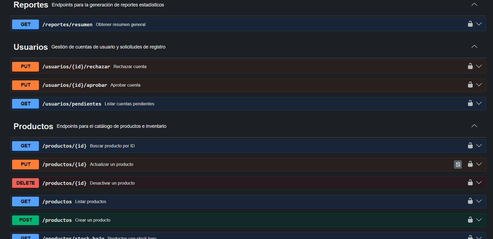
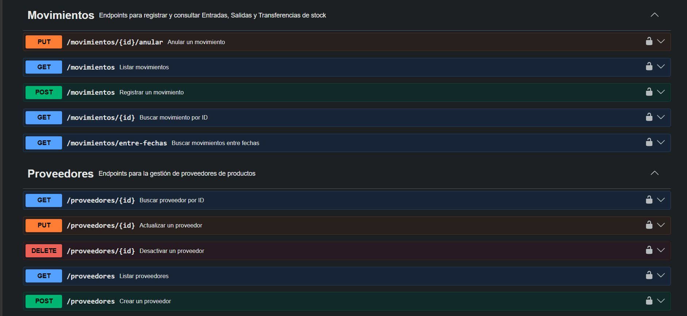
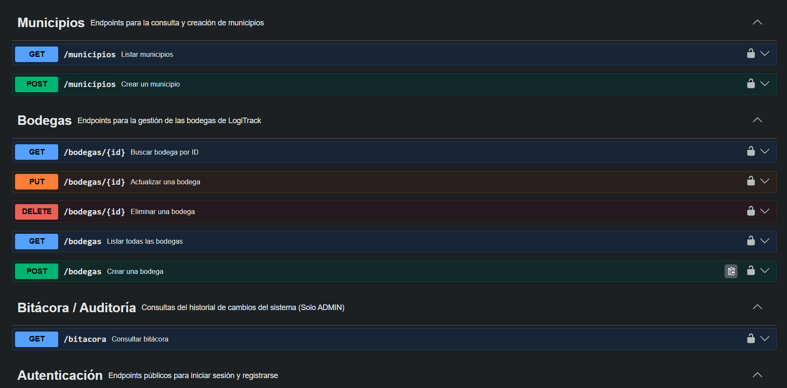
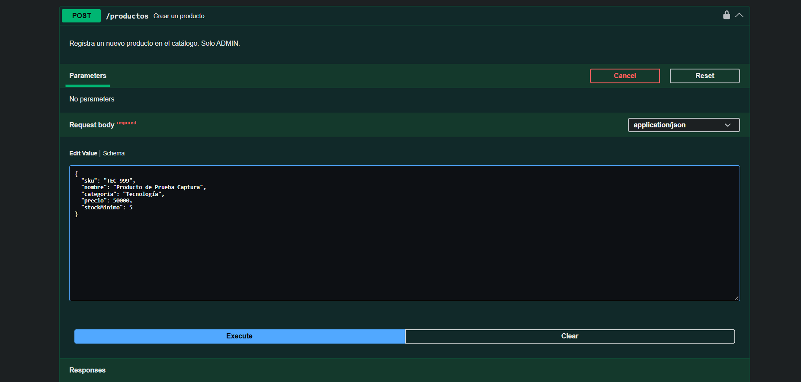
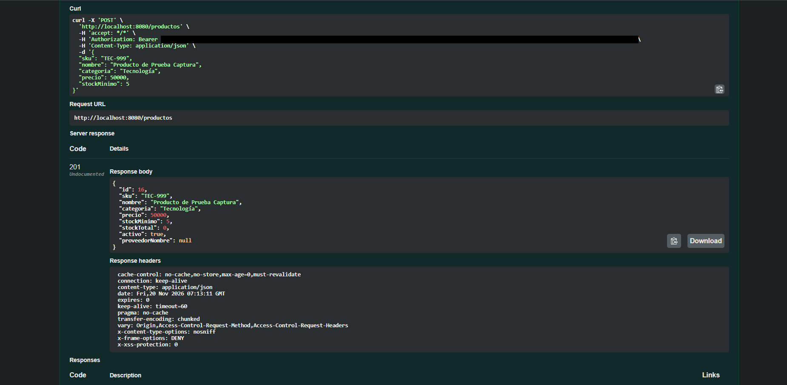
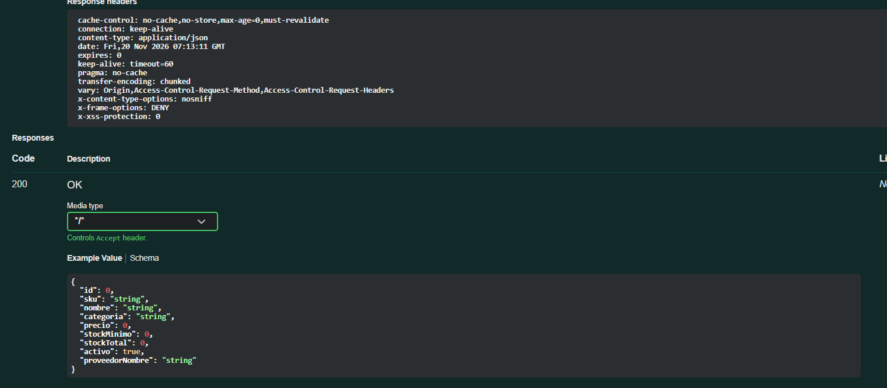
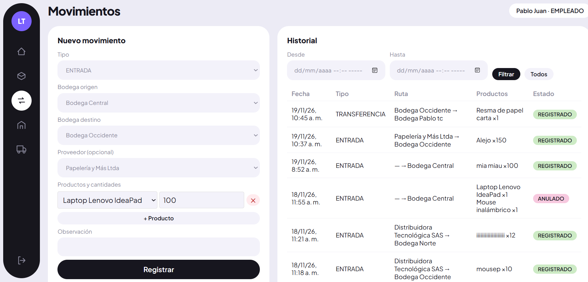

# LogiTrack S.A.
## Sistema Centralizado de Gestión y Control de Inventarios

**Documentación técnica del proyecto**

---

## 1. Descripción del proyecto

LogiTrack S.A. es un sistema web diseñado para centralizar la administración y el control de inventarios de una empresa que opera múltiples bodegas ubicadas en diferentes ciudades.

Anteriormente, la empresa gestionaba sus inventarios mediante hojas de cálculo, lo que dificultaba el seguimiento de las existencias, el control de movimientos, la auditoría de operaciones y la generación de reportes.

Como solución, se desarrolló un backend centralizado que permite administrar productos, proveedores, bodegas, usuarios y movimientos de inventario, garantizando la integridad de la información, la seguridad y la trazabilidad de las operaciones.

El sistema cuenta con una API REST desarrollada en Java y Spring Boot, una base de datos relacional MySQL y una interfaz web construida con HTML5, CSS3 y JavaScript.

### Objetivo general

Desarrollar un sistema centralizado de gestión de inventarios que permita controlar las operaciones de entrada, salida y transferencia de productos entre bodegas, incorporando mecanismos de seguridad, auditoría y generación de reportes.

---

## 2. Tecnologías utilizadas

### Backend

- Java 21.
- Spring Boot 4.1.2.
- Maven.
- Spring Data JPA.
- Hibernate.
- Spring Security.
- JWT mediante JJWT 0.13.0.
- Bean Validation.
- Lombok.
- Swagger / OpenAPI 3 mediante Springdoc.

### Base de datos

- MySQL 8.
- SQL.
- Vistas de base de datos.
- Relaciones y restricciones de integridad.

### Frontend

- HTML5.
- CSS3.
- JavaScript Vanilla.
- Fetch API.
- LocalStorage.

---

## 3. Arquitectura del sistema

El backend implementa una arquitectura en capas que permite separar las responsabilidades y facilitar el mantenimiento del código.

```text
Controller
    |
    v
Service
    |
    v
Repository
    |
    v
MySQL
```

### Capas principales

**Controller**

Gestiona las solicitudes HTTP, recibe los datos enviados por el frontend y expone los endpoints de la API REST.

**Service**

Contiene la lógica de negocio, las validaciones y las operaciones necesarias para garantizar el cumplimiento de las reglas del sistema.

**Repository**

Gestiona el acceso a los datos mediante Spring Data JPA e Hibernate.

### DTOs y mappers

Se utilizan DTOs implementados mediante Java Records para transportar información entre las diferentes capas.

Los mappers manuales permiten convertir las entidades del modelo de datos en objetos de transferencia y viceversa.

---

## 4. Modelo de base de datos

La base de datos está compuesta por nueve tablas principales:

| Tabla | Descripción |
|---|---|
| municipio | Almacena información de los municipios. |
| usuario | Gestiona las cuentas y permisos de los usuarios. |
| proveedor | Almacena la información de los proveedores. |
| bodega | Administra las bodegas y su capacidad. |
| producto | Contiene la información general de los productos. |
| existencia | Controla las cantidades de productos por bodega. |
| movimiento | Registra las operaciones de inventario. |
| movimiento_item | Almacena los detalles de cada movimiento. |
| bitacora_cambios | Conserva el historial de modificaciones. |

### Vistas SQL

El sistema implementa cuatro vistas para facilitar las consultas y los reportes:

| Vista | Funcionalidad |
|---|---|
| `v_inventario_total` | Consulta el inventario general. |
| `v_inventario_por_bodega` | Consulta las existencias por bodega. |
| `v_ocupacion_bodega` | Calcula la ocupación de las bodegas. |
| `v_ranking_movimientos` | Presenta la clasificación de movimientos. |

### Gestión de existencias

El stock no se almacena directamente en la tabla `producto`.

Las cantidades se administran mediante la tabla `existencia`, que relaciona los productos con las bodegas correspondientes.

Las vistas SQL realizan los cálculos necesarios para consolidar las cantidades disponibles.

### Bloqueo optimista

Se implementa bloqueo optimista mediante la anotación `@Version` en la entidad correspondiente a la tabla `existencia`.

Este mecanismo permite detectar modificaciones concurrentes y prevenir inconsistencias cuando varios usuarios intentan actualizar las mismas existencias.

### Auditoría automática

La auditoría se implementa mediante `@EntityListeners` de JPA.

Los cambios realizados sobre las entidades auditadas se almacenan automáticamente en la tabla `bitacora_cambios`, utilizando formato JSON para conservar la información de las modificaciones.

---

## 5. Reglas de negocio

### 5.1 Movimientos de inventario

El sistema contempla tres tipos de movimientos:

| Tipo | Bodega de origen | Bodega de destino | Descripción |
|---|---|---|---|
| ENTRADA | No requiere | Obligatoria | Incrementa las existencias de una bodega. |
| SALIDA | Obligatoria | No requiere | Disminuye las existencias de una bodega. |
| TRANSFERENCIA | Obligatoria | Obligatoria | Traslada productos entre dos bodegas diferentes. |

**Entrada**

- Requiere una bodega de destino.
- Permite asociar un proveedor.
- Incrementa las existencias.
- Valida la capacidad disponible de la bodega receptora.

**Salida**

- Requiere una bodega de origen.
- Disminuye las existencias.
- Valida que exista stock suficiente.

**Transferencia**

- Requiere una bodega de origen y una de destino.
- Las bodegas deben ser diferentes.
- Descuenta las cantidades de la bodega de origen.
- Incrementa las cantidades en la bodega de destino.
- Valida el stock disponible y la capacidad de destino.

### 5.2 Capacidad de las bodegas

El sistema impide registrar operaciones que provoquen que una bodega supere su capacidad máxima.

Esta validación se aplica al recibir mercancía, tanto en entradas como en transferencias.

### 5.3 Seguridad y usuarios

El sistema implementa autenticación mediante Spring Security y JWT.

El proceso de registro funciona de la siguiente manera:

1. El usuario realiza el registro.
2. La cuenta se crea en estado `PENDIENTE`.
3. Un administrador consulta los usuarios pendientes.
4. El administrador puede aprobar o rechazar la solicitud.
5. Si es aprobada, la cuenta cambia al estado `ACTIVA`.

El inicio de sesión genera un token JWT con una duración de 30 minutos.

### 5.4 Borrado lógico

Los productos y proveedores no se eliminan físicamente de la base de datos.

En su lugar, se utiliza el atributo `activo = false` para deshabilitar los registros, conservando su información histórica.

### 5.5 Anulación de movimientos

Los movimientos no se eliminan físicamente.

Cuando se solicita una anulación, el sistema ejecuta una operación inversa que revierte el efecto del movimiento sobre el inventario.

Esto permite conservar la trazabilidad y el historial de las operaciones.

---

## 6. Requisitos previos

Para ejecutar el proyecto se requiere:

- JDK 21.
- MySQL Server 8.
- Maven.
- IDE compatible con Java.
- Visual Studio Code.
- Extensión Live Server.
- Navegador web actualizado.
- Git.

---

## 7. Instalación y ejecución

### 7.1 Clonar el repositorio

```bash
git clone URL_DEL_REPOSITORIO
cd LogiTrack
```

Reemplazar `URL_DEL_REPOSITORIO` por la dirección real del repositorio.

### 7.2 Configurar MySQL

Iniciar MySQL Server o abrir MySQL Workbench.

Crear la base de datos:

```sql
CREATE DATABASE logitrack_db;
```

Ejecutar los archivos SQL en el siguiente orden:

1. `schema.sql`: creación de tablas, relaciones y vistas.
2. `data.sql`: inserción de datos iniciales.

### 7.3 Configurar application.properties

Abrir el archivo:

```text
src/main/resources/application.properties
```

Configurar los parámetros de conexión:

```properties
spring.application.name=LogiTrack

spring.datasource.url=jdbc:mysql://localhost:3306/logitrack_db
spring.datasource.username=root
spring.datasource.password=TU_PASSWORD
spring.datasource.driver-class-name=com.mysql.cj.jdbc.Driver

spring.jpa.hibernate.ddl-auto=validate
spring.jpa.show-sql=true
spring.jpa.properties.hibernate.format_sql=true

server.port=8080
```

Reemplazar los datos de conexión según la configuración local de MySQL.

Con `ddl-auto=validate`, Hibernate verifica la estructura existente sin crear automáticamente las tablas.

Las propiedades adicionales de JWT y Swagger deben conservarse según la configuración del proyecto.

### 7.4 Ejecutar el backend

Desde la terminal, en la raíz del proyecto:

```bash
mvn clean install
```

Después:

```bash
mvn spring-boot:run
```

También es posible ejecutar el proyecto directamente desde el IDE, utilizando JDK 21.

El backend estará disponible en:

```text
http://localhost:8080
```

### 7.5 Ejecutar el frontend

1. Abrir la carpeta `frontend/` en Visual Studio Code.
2. Verificar que la URL de conexión de la API corresponda al backend.
3. Abrir `login.html`.
4. Seleccionar la opción **Open with Live Server**.
5. Iniciar sesión con una cuenta habilitada.

El backend debe permitir mediante CORS el origen desde el cual se ejecuta Live Server.

---

## 8. Endpoints principales

### Autenticación

| Método | Endpoint | Descripción |
|---|---|---|
| POST | `/auth/login` | Iniciar sesión. |
| POST | `/auth/register` | Registrar usuario. |

### Usuarios

| Método | Endpoint | Descripción |
|---|---|---|
| GET | `/usuarios/pendientes` | Consultar usuarios pendientes. |
| PUT | `/usuarios/{id}/aprobar` | Aprobar usuario. |
| PUT | `/usuarios/{id}/rechazar` | Rechazar usuario. |

### Bodegas

| Método | Endpoint | Descripción |
|---|---|---|
| CRUD | `/bodegas` | Administrar bodegas. |

### Productos

| Método | Endpoint | Descripción |
|---|---|---|
| CRUD | `/productos` | Administrar productos. |
| GET | `/productos/stock-bajo` | Consultar productos con stock bajo. |

### Proveedores

| Método | Endpoint | Descripción |
|---|---|---|
| CRUD | `/proveedores` | Administrar proveedores. |

### Movimientos

| Método | Endpoint | Descripción |
|---|---|---|
| POST | `/movimientos` | Registrar movimiento. |
| GET | `/movimientos` | Consultar movimientos. |
| GET | `/movimientos/entre-fechas` | Consultar movimientos por fechas. |
| PUT | `/movimientos/{id}/anular` | Anular movimiento. |

### Reportes

| Método | Endpoint | Descripción |
|---|---|---|
| GET | `/reportes/resumen` | Consultar resumen general. |

---

## 9. Ejemplos de solicitudes JSON

> Los siguientes ejemplos son ilustrativos. Los nombres de los atributos deben contrastarse con los DTOs reales del proyecto.

### 9.1 Login

**Request**

```http
POST /auth/login
Content-Type: application/json
```

```json
{
  "username": "admin",
  "password": "Admin123*"
}
```

**Response**

```json
{
  "token": "eyJhbGciOiJIUzI1NiJ9...",
  "type": "Bearer",
  "expiresIn": 1800,
  "username": "admin",
  "role": "ADMIN"
}
```

Para acceder a endpoints protegidos se debe enviar el token:

```http
Authorization: Bearer <TOKEN>
```

### 9.2 Crear producto

**Request**

```http
POST /productos
Content-Type: application/json
Authorization: Bearer <TOKEN>
```

```json
{
  "nombre": "Teclado mecánico",
  "descripcion": "Teclado mecánico USB",
  "codigo": "TEC-001",
  "precio": 150000,
  "activo": true
}
```

**Response**

```json
{
  "id": 1,
  "nombre": "Teclado mecánico",
  "descripcion": "Teclado mecánico USB",
  "codigo": "TEC-001",
  "precio": 150000,
  "activo": true
}
```

La creación del producto no genera existencias automáticamente. El inventario se administra mediante los movimientos correspondientes.

### 9.3 Registrar movimiento de entrada

**Request**

```http
POST /movimientos
Content-Type: application/json
Authorization: Bearer <TOKEN>
```

```json
{
  "tipo": "ENTRADA",
  "bodegaOrigenId": null,
  "bodegaDestinoId": 1,
  "proveedorId": 1,
  "observacion": "Recepción de mercancía",
  "items": [
    {
      "productoId": 1,
      "cantidad": 50
    },
    {
      "productoId": 2,
      "cantidad": 20
    }
  ]
}
```

**Response**

```json
{
  "id": 1,
  "tipo": "ENTRADA",
  "estado": "REGISTRADO",
  "bodegaOrigenId": null,
  "bodegaDestinoId": 1,
  "proveedorId": 1,
  "observacion": "Recepción de mercancía",
  "items": [
    {
      "productoId": 1,
      "cantidad": 50
    },
    {
      "productoId": 2,
      "cantidad": 20
    }
  ]
}
```

La operación valida la capacidad de la bodega y las cantidades solicitadas antes de actualizar las existencias.

---

## 10. Frontend y conexión con el backend

La carpeta `frontend/` contiene los archivos responsables de la interfaz web y la comunicación con la API REST.

| Archivo | Función |
|---|---|
| `login.html` | Pantalla de inicio de sesión. |
| `dashboard.html` | Panel principal del sistema. |
| `api.js` | Centraliza las solicitudes HTTP mediante `apiFetch`. |
| `app.js` | Gestiona los eventos y la lógica de la interfaz. |

### Función apiFetch

La función `apiFetch` centraliza las solicitudes HTTP realizadas desde JavaScript.

Su responsabilidad es:

- Construir las solicitudes hacia el backend.
- Incorporar el token JWT cuando exista.
- Enviar encabezados HTTP.
- Procesar las respuestas.
- Gestionar errores HTTP.

Ejemplo de referencia:

```javascript
const API_URL = "http://localhost:8080";

async function apiFetch(endpoint, options = {}) {
  const token = localStorage.getItem("token");

  const headers = {
    "Content-Type": "application/json",
    ...options.headers
  };

  if (token) {
    headers.Authorization = `Bearer ${token}`;
  }

  const response = await fetch(`${API_URL}${endpoint}`, {
    ...options,
    headers
  });

  if (!response.ok) {
    throw new Error(`Error HTTP: ${response.status}`);
  }

  if (response.status === 204) return null;

  return response.json();
}
```

### Almacenamiento del token JWT

Después de iniciar sesión, el frontend almacena el token recibido:

```javascript
localStorage.setItem("token", data.token);
```

El token se utiliza posteriormente en las solicitudes protegidas.

Para cerrar sesión:

```javascript
localStorage.removeItem("token");
```

**Nota de seguridad:** LocalStorage es accesible desde JavaScript. En un entorno de producción deben evaluarse los riesgos XSS y alternativas como cookies `HttpOnly`, `Secure` y `SameSite`.

---

## 11. Documentación Swagger / OpenAPI

El proyecto utiliza Swagger / OpenAPI 3 para documentar y probar los servicios REST.

Con el backend iniciado, acceder a:

**Swagger UI**

```text
http://localhost:8080/swagger-ui/index.html
```

**Especificación OpenAPI**

```text
http://localhost:8080/v3/api-docs
```

Desde Swagger es posible:

- Consultar los endpoints disponibles.
- Revisar los parámetros de entrada.
- Visualizar los esquemas de datos.
- Ejecutar solicitudes HTTP.
- Consultar las respuestas del servidor.
- Probar la autenticación Bearer cuando esté configurada.

---

## 12. Evidencias de funcionamiento

### 12.1 Swagger UI


### 12.2 Movimientos y Proveedores (Swagger)


### 12.3 Municipios y Bodegas (Swagger)


### 12.4 Creación de producto (Swagger)






### 12.5 Registro de movimiento (Historial)


## 13. Credenciales de prueba

| Rol | Usuario | Contraseña |
|---|---|---|
| Administrador | `admin` | `Admin123*` |
| Empleado | `empleado1` | `Empleado123*` |

Estas credenciales son exclusivamente para pruebas y deben verificarse en los datos iniciales del proyecto.

No deben utilizarse en producción.

---

## 14. Estructura del repositorio

```text
LogiTrack/
│
├── src/
│   └── main/
│       ├── java/
│       │   └── <paquete-base>/
│       │       ├── controller/
│       │       ├── service/
│       │       ├── repository/
│       │       ├── entity/
│       │       ├── dto/
│       │       ├── mapper/
│       │       ├── security/
│       │       └── config/
│       │
│       └── resources/
│           └── application.properties
│
├── frontend/
│   ├── login.html
│   ├── dashboard.html
│   ├── app.js
│   ├── api.js
│   └── css/
│
├── database/
│   ├── schema.sql
│   └── data.sql
│
├── pom.xml
└── README.md
```

El backend se encuentra en `src/main/java`, mientras que los recursos de configuración están en `src/main/resources`.

La interfaz web se encuentra en `frontend/` y los scripts de creación y población de la base de datos en `database/`.

La estructura presentada es una referencia y debe ajustarse a la distribución real del repositorio.

---

## 15. Consideraciones finales

- Iniciar MySQL antes de ejecutar el backend.
- Verificar los parámetros de conexión.
- Ejecutar `schema.sql` antes de `data.sql`.
- Comprobar las propiedades de seguridad JWT.
- Utilizar tokens válidos para acceder a los endpoints protegidos.
- Mantener las operaciones de inventario dentro de transacciones.
- Conservar el historial mediante borrado lógico y anulación.
- No publicar credenciales ni secretos reales.
- Verificar los contratos JSON contra los DTOs implementados.

---

**LogiTrack S.A.**  
*Sistema Centralizado de Gestión y Control de Inventarios.*
